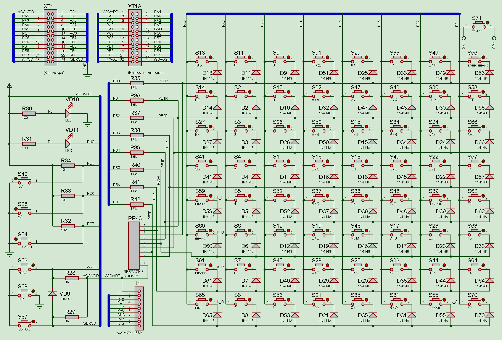
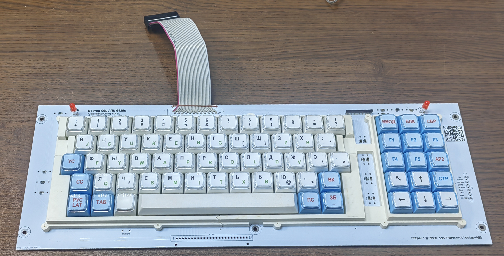

## Modification of the keyboard with diodes for each button

This PCB is designed in Proteus 7 for use with Cherry MX (5pin) keys. The circuit and size of the board corresponds to the keyboard of the PC "Вектор-06ц" and "ПК-6128ц".

* [KBDVektorG4.DSN](/MOD4/KBDVektorG4.DSN) -- circuit 
* [KBDVektorG4.LYT](/MOD4/KBDVektorG4.LYT) -- PCB layout 
* [KBDVektorG4 - CADCAM.ZIP](/MOD4/KBDVektorG4%20-%20CADCAM.ZIP) -- gerber file for production PCB 
* [FrameG4_1.stl](/MOD4/FrameG4_1.stl), [FrameG4_1.stl](/MOD4/FrameG4_1.stl) -- 3D models of the keyboard frame for printing 
* [SPACE_BAL.stl](/MOD4/SPACE_BAL.stl) -- Eyelet for the balance rod

